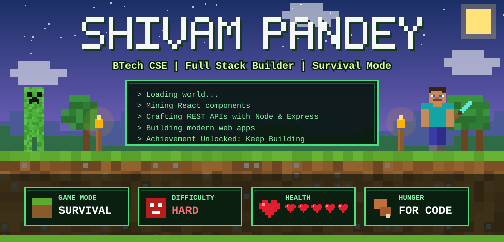
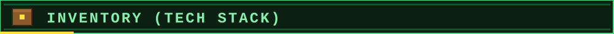
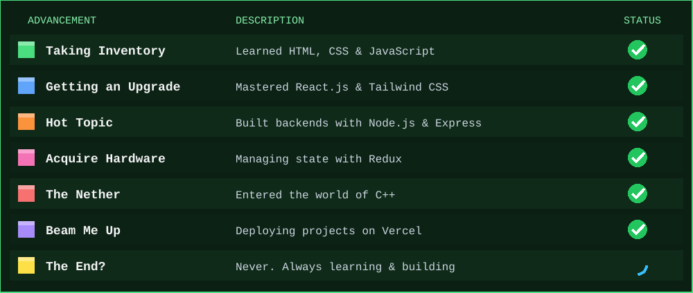
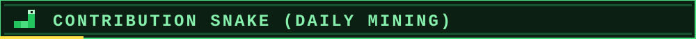
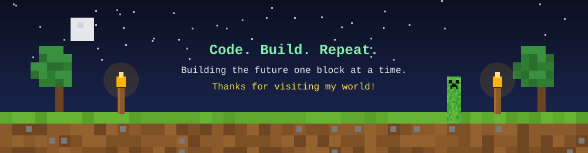

<div align="center">



<br/>


<br/>

<a href="https://www.linkedin.com/in/shivampandey1818/"></a>
<a href="https://github.com/shivampandey2006"></a>


</div>

<br/>

<!-- ===================== PLAYER PROFILE ===================== -->


<table>
<tr>
<td align="center" width="170">

</td>
<td>

```yaml
Player      : Shivam Pandey
Class       : BTech - Computer Science Eng.
Main Weapon : React.js + Node.js
Side Quest  : C++ & Problem Solving
Spawn Point : The Web
Objective   : Turn ideas into real products
```

I'm a **BTech Computer Science Engineering student** focused on building modern and scalable web applications. I love turning ideas into interactive products, and I keep levelling up across the frontend and backend ecosystem, one block at a time. ⛏️

</td>
</tr>
</table>

<br/>

<!-- ===================== INVENTORY ===================== -->



<div align="center">

<table>
<tr>
<td align="center"><b>🟩 Frontend</b></td>
<td align="center"><b>🟫 Backend</b></td>
<td align="center"><b>🟪 Programming & State</b></td>
<td align="center"><b>⬛ Tools & Platforms</b></td>
</tr>
<tr>
<td align="center"></td>
<td align="center"></td>
<td align="center"></td>
<td align="center"></td>
</tr>
</table>

</div>


<!-- ===================== ADVANCEMENTS ===================== -->





<!-- ===================== SNAKE ===================== -->



<div align="center">


</div>

<br/>

<!-- ===================== WORLD STATS ===================== -->


<div align="center">

<br/>


<br/>


</div>

<br/>

<!-- ===================== CONNECT ===================== -->


<div align="center">

<br/>

<a href="https://www.linkedin.com/in/shivampandey1818/"></a>
&nbsp;
<a href="https://github.com/shivampandey2006"></a>

<br/><br/>



</div>
